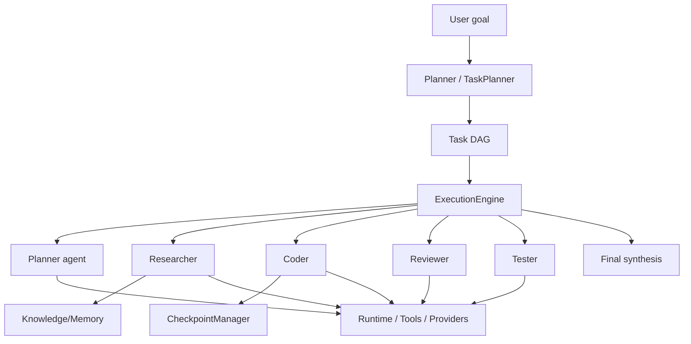

# Agent Orchestration

## Multi-agent architecture

## Components (`src/orchestrator/` + `src/intelligence/`)

| Component | File | Role |
|-----------|------|------|
| Agent registry | `registry/agent-registry.ts` | Register built-in + user agents (planner, coder, reviewer, …) |
| Planner | `planner/task-planner.ts` | Decompose goal → DAG of tasks |
| Execution engine | `execution/execution-engine.ts` | DAG runner, parallel/serial scheduling, retries |
| Checkpoints | `checkpoints/checkpoint-manager.ts` | State snapshots before/after each step; branching |
| Reasoning | `intelligence/reasoning/reasoning-engine.ts` | Chain-of-thought, ReAct scaffolding |
| Reflection | `intelligence/reflection/reflection-engine.ts` | Self-critique after each step |
| Planning | `intelligence/planning/planning-engine.ts` | Higher-level strategy adjustments |
| Coordination | `intelligence/coordination/coordination-engine.ts` | Multi-agent hand-off, shared state |
| Evaluation | `intelligence/evaluation/evaluation-engine.ts` | Goal-completion scoring |
| Optimization | `intelligence/optimization/optimization-engine.ts` | Self-improvement from feedback |
| Runtime manager | `runtime/orchestrator/runtime-manager.ts` | Sandbox/container lifecycle per agent step |
| Runtime memory | `runtime/memory/runtime-memory.ts` | Scratchpad + shared blackboard |

## Lifecycle of an agent run

1. User submits goal (chat `/goal <…>` or API `POST /orchestrator/goals`).
2. Planner produces a DAG of tasks, each assigned an agent role.
3. A checkpoint is taken before execution.
4. Execution engine runs tasks respecting dependencies; parallel when independent.
5. Each agent receives: goal, prior results, relevant memory, approved tools.
6. Tools are executed (with approvals when needed).
7. After each step, reflection + evaluation may trigger replanning.
8. Final answer is synthesized; events emitted for UI updates.
9. Checkpoints kept for branching / restore.

## Failure handling

- Per-step retry with exponential backoff.
- Provider fallback (see [provider-flow.md](provider-flow.md)).
- Circuit breaker trips stop cascades.
- Checkpoint restore on critical failure → user sees “Resume?”
- Audit log entry for every agent decision.

## Distributed execution
`src/cluster/` enables horizontal agent workers across nodes; coordination is via
Redis-backed distributed event bus and service registry (`cluster/coordinator/*`).
