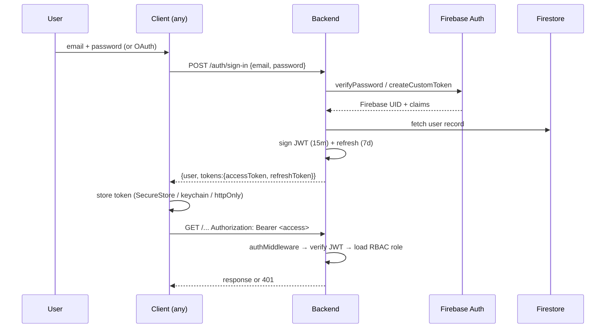

# Authentication & Authorization

## Authentication flows

## Token handling

- **Access token**: JWT HS256, 15-minute TTL, signed with `JWT_SECRET`. Includes `uid`, `orgId`, `role`.
- **Refresh token**: 7-day TTL, stored in Firebase custom token or secure storage; rotate on use.
- **API keys**: separate long-lived keys with scoped permissions (see `src/modules/apikeys/`).
- Mobile: `apps/mobile/security/secure-storage.ts` uses `expo-secure-store`.
- Electron: preload bridge stores in OS keychain.
- CLI: `packages/cli/src/config/store.ts` (Conf + system keychain integration).

## Authorization

- `src/modules/rbac/rbac.service.ts` maps roles → permissions: `owner`, `admin`, `member`, `viewer`.
- Route-level middleware: `authMiddleware(authClient, rbac)` resolves the principal; route handlers can assert specific roles via `requireRole()`.
- Enterprise policy engine (`src/enterprise/policies/policy-engine.ts`) evaluates attribute-based policies for compliance / DLP.
- API key scopes: `read`, `write`, `admin`.

## Security layers

| Concern | Solution | File |
|---------|----------|------|
| Password storage | Firebase Auth (Argon2/bcrypt internally) | Firebase |
| Data in transit | HTTPS only, HSTS headers | `middleware/security-headers.ts` |
| XSS | Output-escaping + sanitization | `services/security/xss-protection.ts` |
| CSRF | SameSite cookies + origin checks | `services/security/csrf-protection.ts` |
| Rate limit | Sliding-window via Redis | `middleware/rate-limit.ts` |
| Abuse/abuse detection | Heuristic + rate anomalies | `services/security/abuse-detection.ts` |
| Secrets at rest | AES-256-GCM via `encryption.ts` | `services/security/encryption.ts` |
| Biometric lock (mobile) | `expo-local-authentication` | `apps/mobile/hooks/use-biometrics.ts` |
| Zero-trust guards | Per-request policy checks | `services/security/zero-trust.ts` |

## Related files

- `src/modules/auth/auth.service.ts` — sign-in/up, token issuance
- `src/middleware/auth.ts` — JWT verification
- `src/modules/rbac/rbac.service.ts` — role/permission checks
- `src/modules/apikeys/` — API key management
- `src/services/security/*` — security primitives
