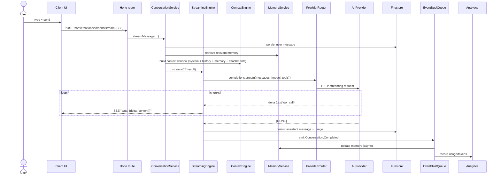

# Conversation Flow



## Message lifecycle

1. **Draft** — client side (mobile/web: MMKV/localStorage drafts per conversation).
2. **Sent** — persisted to `conversations/{cid}/messages/{mid}`.
3. **Streaming** — assistant message is created with `streaming: true`; SSE fills content.
4. **Complete / Error / Cancelled** — final state; error state carries a retry affordance in clients.

## Context construction (`context-engine.ts`)

- System prompt template (`prompt-templates.ts`)
- Summarized history older than N turns (via `summarizer` from knowledge)
- Retrieval results from workspace index (if enabled)
- Long-term memory snippets
- Active tool results
- Attachments (images → vision model; files → truncated + embedded)

## Streaming protocol (SSE)

```
data: {"delta": {"content": "Hel"}}
data: {"delta": {"content": "lo"}}
data: {"delta": {"tool_calls": [...]}}
data: "[DONE]"
```

- Content-type: `text/event-stream`
- Connection: keep-alive
- Error frames sent as `data: {"error": {code, message}}` before closing.

## Attachments

- Uploaded to Firebase Cloud Storage via signed URLs.
- Message records contain `attachments: [{uri, type, name}]`.
- Vision-capable providers receive base64/signed URLs as image blocks.

## Branching / checkpoints

Checkpoints are taken before tool calls in multi-step execution. Clients can
restore a previous checkpoint to create a branch — see `src/orchestrator/checkpoints/`.
