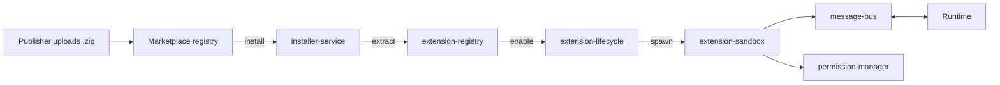

# Extension Flow

Extensions are third-party packages that add capabilities to CODER: tools,
prompts, UI panes, event handlers. They run in a sandboxed runtime.

## Lifecycle



States: `installed → enabled → running → stopped → disabled → uninstalled`.

## Components (`src/extensions/`)

| Module | Responsibility |
|--------|---------------|
| `registry/extension-registry.ts` | CRUD, listing, metadata queries |
| `lifecycle/extension-lifecycle.ts` | Install, enable, disable, upgrade, hooks |
| `sandbox/extension-sandbox.ts` | Isolated execution (VM context with restricted globals) |
| `messaging/message-bus.ts` | JSON-RPC style IPC between host ↔ extension |
| `permissions/permission-manager.ts` | Grant/revoke scopes, runtime checks |
| `dependencies/dependency-resolver.ts` | NPM-style semver resolver for peer extensions |
| `storage/extension-storage.ts` | Per-extension isolated KV store |
| `marketplace/extension-marketplace.ts` | Discover/search across marketplace catalog |

## Extension manifest (simplified)

```json
{
  "name": "coder-github",
  "version": "1.0.0",
  "permissions": ["tools:execute", "network:api.github.com"],
  "contributes": {
    "tools": [{ "name": "github.issues", "description": "List GitHub issues" }],
    "commands": [{ "id": "github.link", "title": "Link repository" }]
  }
}
```

## Marketplace (`src/marketplace/`)

- `registry/package-registry.ts` — hosted package metadata
- `publishers/publisher-service.ts` — publisher verification
- `installers/installer-service.ts` — download/verify/unpack
- `ratings/rating-service.ts` — user reviews
- `moderation/moderation-service.ts` — automated and manual moderation
