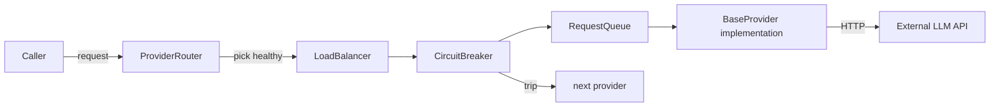

# Provider Flow

AI providers are abstracted behind `BaseProvider`. All user/agent completions flow
through a resilience stack before hitting an external API.

## Implementations (`src/modules/providers/implementations/`)

| Provider | Streaming | Tools | Vision | Embeddings | Image gen | Reasoning |
|----------|-----------|-------|--------|------------|-----------|-----------|
| openai | ✅ | ✅ | ✅ | ✅ | ✅ | ✅ (o-series) |
| anthropic | ✅ | ✅ | ✅ | — | — | ✅ |
| gemini | ✅ | ✅ | ✅ | ✅ | ✅ | ✅ |
| openrouter | ✅ | ✅ | ✅ | — | — | ✅ |
| ollama | ✅ | ✅ | ✅ | ✅ | — | — |
| groq | ✅ | ✅ | ✅ | — | — | — |

## Resilience (`src/modules/providers/resilience/`)

### Circuit breaker
States: `closed → open → half-open`. On N consecutive failures within a window,
opens for a cool-down, then probes before closing again.

### Load balancer
Strategies: `round-robin`, `least-latency` (EWMA), `weighted-random`, `priority`
(e.g., prefer cheaper/faster models, fall back to higher capacity). Tracks per-key
rate-limit budgets and rebalances.

### Request queue
Bounded queue with concurrency limits, priority (interactive > background), and
deadline propagation. Coalesces multiple small requests where safe.

### Fallback
When a provider returns a 5xx / rate-limit / circuit-open, the router retries on
the next healthy provider of equivalent capability (vision-capable → vision-capable).

## Adding a provider
1. Create `src/modules/providers/implementations/<name>.provider.ts` extending
   `BaseProvider` (`chat()`, `stream()`, `embed()`, `image()` optional).
2. Register in `implementations/index.ts`.
3. Add factory case in `provider-factory.ts`.
4. Add capability flags in `provider-registry.ts`.
