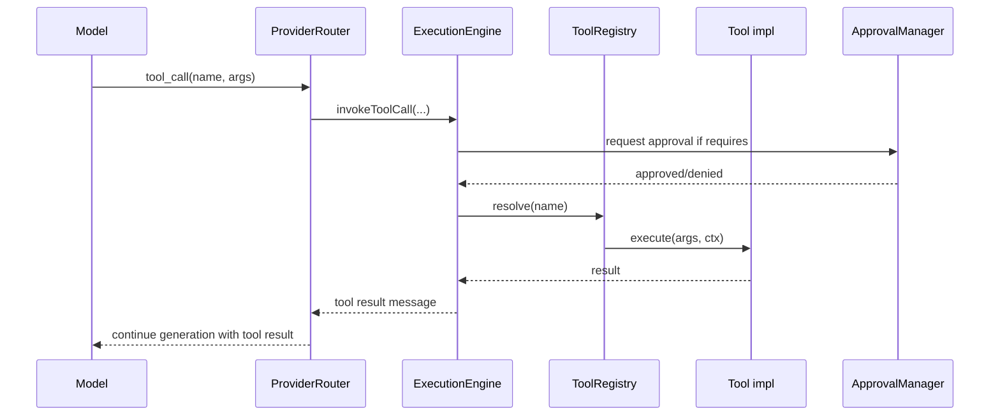

# Tool Execution

Tools are strongly-typed functions exposed to models. They can be built-in
(shell, filesystem, git, …) or provided by extensions.

## Registry

`src/tools/registry/tool-registry.ts` is the singleton registry:

```ts
toolRegistry.register({
  name: 'shell.exec',
  description: 'Run a shell command in the workspace',
  inputSchema: z.object({ command: z.string(), cwd: z.string().optional() }),
  async execute(args, ctx) { ... }
});
```

## Execution flow



## Built-in tools (`src/tools/`)

| Tool | Module | Capability |
|------|--------|-----------|
| Shell | `shell/shell.tool.ts` | Run arbitrary commands (sandboxed, approvable) |
| Filesystem | `filesystem/filesystem.tool.ts` | Read, write, list, stat files |
| Git | `git/git.tool.ts` | status, diff, commit, branch, log |
| Browser | `browser/browser.tool.ts` | Headless browser navigation + scraping |
| Docker | `docker/docker.tool.ts` | Container run/exec |
| Search | `search/search.tool.ts` | Semantic + keyword search over workspace |
| MCP | `mcp/mcp.tool.ts` | Model Context Protocol adapter |

## Sandboxing

- Shell tool runs in a configurable sandbox (chroot/container in production,
  cwd-restricted in dev).
- Network egress can be disabled per policy.
- Runtime policies (`src/runtime/policies/runtime-policies.ts`) enforce allowed
  binaries, timeouts, and max output size.
- Long-running tool calls yield streaming progress events.

## Approvals

`src/runtime/approvals/approval-manager.ts` gates dangerous tools
(e.g. `rm -rf`, production deployments). Approvals can be automatic,
per-session, or require human-in-the-loop through any connected client.
