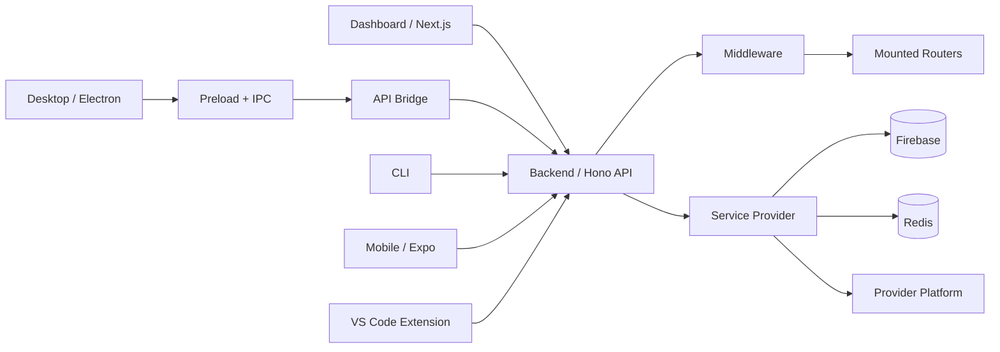
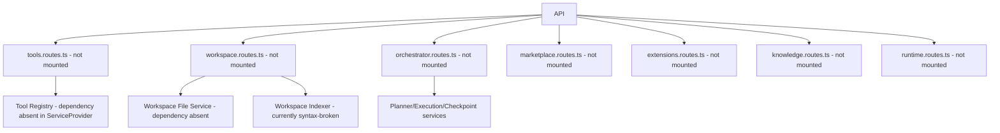
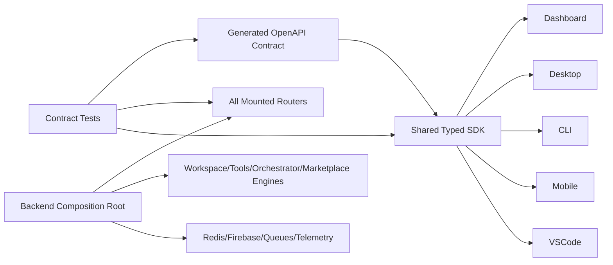

# Architecture Report

## Current Architecture

## Intended-but-not-fully-connected Architecture

## Architectural Risks

1. Multiple client API implementations duplicate endpoint strings instead of importing one generated SDK.
2. Backend feature modules are file-present but not composition-root-present.
3. Tool/workspace/orchestrator route dependencies are not created in `ServiceProvider`.
4. Auth mode differs by client family.
5. Eventing, queues, schedulers and workers are not part of app lifecycle.

## Recommended Target Architecture

